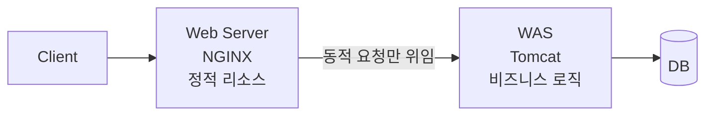
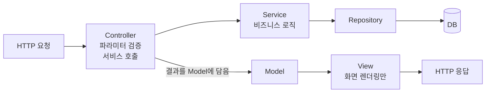
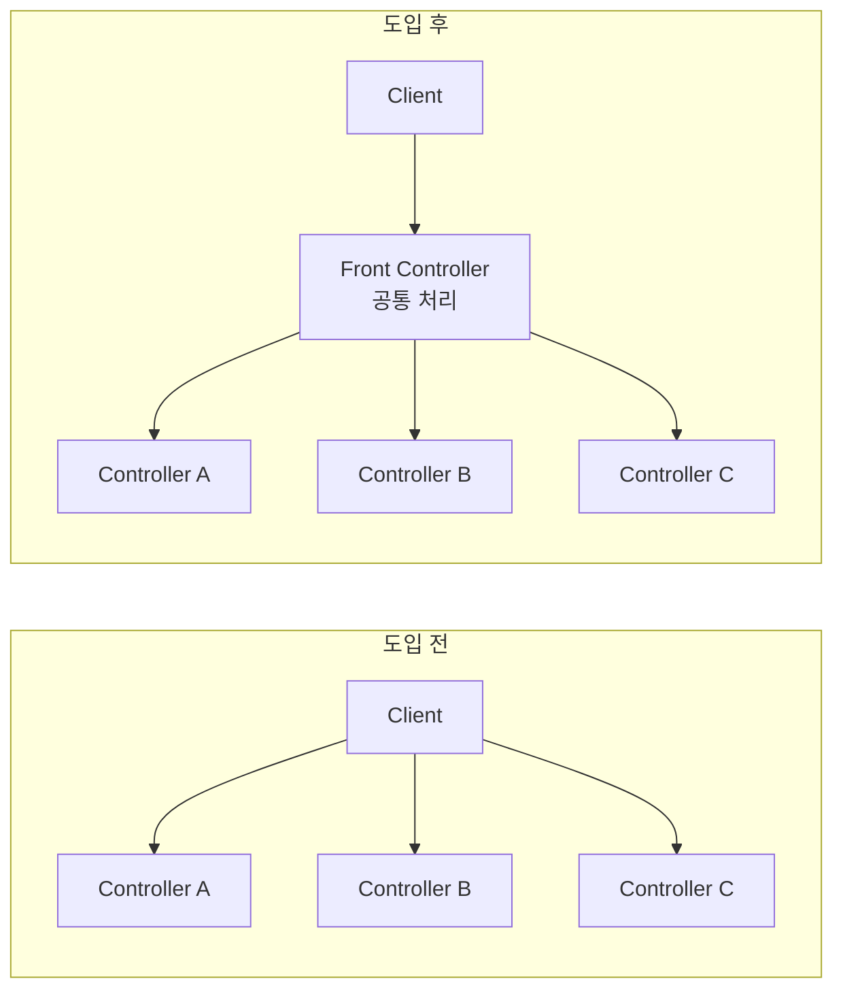
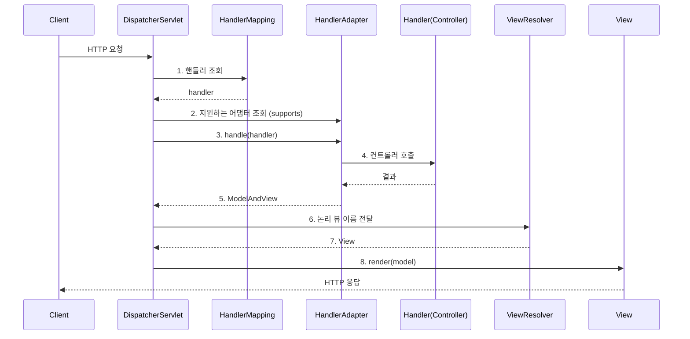

# 🌱 스프링 MVC 1편 — 실무 중심 정리 (1~4장)

> **정리 기준**
> - ✅ **실무 핵심** : 지금도 매일 쓰거나, 장애·튜닝·설계 때 반드시 알아야 하는 내용 → 자세히
> - 📦 **원리 이해용** : 직접 쓰진 않지만 스프링이 내부에서 대신 해주는 것 → 스프링에서 어떻게 쓰는지와 함께 짧게
> - 🗑️ **레거시** : 요즘 실무에서 안 쓰는 내용 → 한 줄 요약
>
> 각 챕터 끝에 **💬 꼬리질문**이 있습니다. 답은 `▶ 답변 보기`를 눌러 확인하세요.

---

## 📑 목차

1. [웹 애플리케이션 이해](#1-웹-애플리케이션-이해)
   - [1-1. 웹 서버 vs WAS](#1-1-웹-서버-vs-was)
   - [1-2. 웹 시스템 구성](#1-2-웹-시스템-구성)
   - [1-3. 서블릿과 서블릿 컨테이너](#1-3-서블릿과-서블릿-컨테이너)
   - [1-4. 멀티 쓰레드와 쓰레드 풀](#1-4-멀티-쓰레드와-쓰레드-풀)
   - [1-5. HTML · HTTP API · SSR · CSR](#1-5-html--http-api--ssr--csr)
   - [1-6. 자바 웹 기술 역사](#1-6-자바-웹-기술-역사)
2. [서블릿](#2-서블릿)
   - [2-1. 프로젝트 설정 (Spring Boot 3)](#2-1-프로젝트-설정-spring-boot-3)
   - [2-2. HTTP 요청 데이터 3가지](#2-2-http-요청-데이터-3가지)
   - [2-3. HTTP 응답](#2-3-http-응답)
3. [서블릿, JSP, MVC 패턴](#3-서블릿-jsp-mvc-패턴)
4. [MVC 프레임워크 만들기](#4-mvc-프레임워크-만들기)
- [🧭 한 장 요약](#-한-장-요약)

---

## 1. 웹 애플리케이션 이해

> 💡 HTTP 위에서 모든 것이 오간다. HTML, 이미지, 파일, **JSON(API)**, 서버 간 통신까지 대부분 HTTP를 쓴다.

### 1-1. 웹 서버 vs WAS

| 구분 | 웹 서버 (Web Server) | WAS (Web Application Server) |
|---|---|---|
| 역할 | **정적 리소스** 제공 (HTML, CSS, JS, 이미지) | **애플리케이션 로직 실행** (동적 HTML, JSON API) |
| 예시 | NGINX, Apache | Tomcat, Jetty, Undertow |
| 특징 | 잘 안 죽음, 가벼움 | 비싼 로직을 돌림, 상대적으로 잘 죽음 |

- 실제로는 경계가 모호하다. WAS도 정적 파일을 줄 수 있고, 웹 서버도 일부 로직을 돌린다.
- 자바에서는 **서블릿 컨테이너 기능을 제공하면 WAS**라고 부른다.

### 1-2. 웹 시스템 구성



**✅ 실무 포인트**
- **WAS + DB만 쓰면?** WAS가 정적 파일까지 처리해서 과부하가 생기고, WAS가 죽으면 **오류 페이지조차 못 보여준다.**
- **Web + WAS + DB로 나누면?**
  - 정적 요청이 많으면 웹 서버를, API 요청이 많으면 WAS를 **따로 늘릴 수 있다.**
  - WAS나 DB가 죽어도 웹 서버가 **오류 페이지(502/503)** 를 보여준다.
- 요즘은 정적 리소스를 **CDN(CloudFront 등)** 이나 S3에 두고, NGINX는 **리버스 프록시·로드밸런서** 역할만 하는 구성이 흔하다.
- API 서버만 운영할 때는 웹 서버 없이 **로드밸런서(ALB) → WAS**로 가기도 한다.

### 1-3. 서블릿과 서블릿 컨테이너

> 📦 **원리 이해용**: 서블릿을 직접 짜는 일은 거의 없다. 하지만 스프링 MVC의 `DispatcherServlet`도 결국 **서블릿 하나**다.

서블릿이 해주는 일은 **HTTP 파싱 같은 귀찮은 작업을 대신 처리하고, 개발자는 비즈니스 로직만 짜게 해주는 것**이다.

```java
@WebServlet(name = "helloServlet", urlPatterns = "/hello")
public class HelloServlet extends HttpServlet {
    @Override
    protected void service(HttpServletRequest request, HttpServletResponse response) {
        // 비즈니스 로직만 작성
    }
}
```

**요청 흐름**
1. HTTP 요청이 들어오면 WAS가 `Request`, `Response` 객체를 **새로 만든다.**
2. URL에 맞는 서블릿을 호출한다.
3. 개발자가 `Response`에 응답 정보를 넣는다.
4. WAS가 그 내용으로 HTTP 응답 메시지를 만든다.

**✅ 서블릿 컨테이너 핵심 (스프링 빈에도 그대로 적용됨)**
- 서블릿 객체는 **싱글톤**으로 관리한다. 처음 로딩할 때 만들어두고 재활용한다.
- 모든 요청이 **같은 인스턴스**를 공유한다 → **⚠️ 공유 변수(필드)에 상태를 저장하면 안 된다.**
- 동시 요청을 위해 **멀티 쓰레드**로 처리한다.

> 🔥 **실무 사고 사례**: `@Service`나 `@Controller`에 `private String currentUser;` 같은 필드를 두면, 여러 사용자의 요청이 섞여서 **다른 사람의 데이터가 노출된다.** 상태는 지역 변수, 파라미터, `ThreadLocal`(주의해서)로만 다룬다.

### 1-4. 멀티 쓰레드와 쓰레드 풀

| 방식 | 장점 | 단점 |
|---|---|---|
| 요청마다 쓰레드 생성 | 동시 처리 가능 | 생성 비용이 비쌈, 개수 제한이 없어 **요청이 몰리면 서버 다운** |
| **쓰레드 풀** ✅ | 미리 만들어둔 쓰레드 재사용, **최대 개수 제한**으로 서버 보호 | 최대치를 넘으면 대기하거나 거절 |

- Tomcat 기본 최대 쓰레드는 **200개**다.
- 풀이 꽉 차면 요청은 **대기(accept-count)** 하거나 **거절**된다.

**✅ 실무 튜닝 포인트 — `max thread`**

```yaml
# application.yml (Spring Boot)
server:
  tomcat:
    threads:
      max: 200        # 최대 쓰레드 (기본 200)
      min-spare: 10   # 최소 유지 쓰레드
    accept-count: 100 # 풀이 꽉 찼을 때 대기 큐 크기
    max-connections: 8192
```

| 설정 | 증상 |
|---|---|
| 너무 낮음 | CPU는 5%로 여유로운데 **클라이언트 응답이 느려짐** |
| 너무 높음 | CPU/메모리 한계를 넘어서 **서버 다운** |

- **적정값 찾는 법**: 실제 서비스와 비슷하게 **성능 테스트**를 한다. (도구: nGrinder, JMeter, k6, Gatling)
- **장애가 나면**: 클라우드는 일단 **스케일 아웃(서버 증설)** 부터 하고 원인을 튜닝한다.
- 📌 쓰레드 수만이 아니라 **DB 커넥션 풀(HikariCP `maximum-pool-size`)** 과 균형이 맞아야 한다. 쓰레드 200개인데 커넥션이 10개면 190개가 커넥션을 기다린다.
- 📌 Java 21 이상과 Spring Boot 3.2 이상에서는 `spring.threads.virtual.enabled=true`로 **가상 쓰레드**를 쓸 수 있다. 블로킹 I/O가 많은 서비스에서 쓰레드 풀 한계를 크게 줄여준다.

**핵심**: 멀티 쓰레드는 WAS가 알아서 처리한다. 개발자는 싱글 쓰레드처럼 코드를 짜되, **싱글톤 객체(서블릿, 스프링 빈)의 공유 상태만 조심하면 된다.**

### 1-5. HTML · HTTP API · SSR · CSR

서버가 응답으로 주는 것은 크게 세 가지다.

| 종류 | 내용 | 예시 |
|---|---|---|
| 정적 리소스 | 고정된 파일 | `/hello.html`, `a.jpg` |
| HTML 페이지 | 서버가 **동적으로 HTML 생성** | Thymeleaf, JSP |
| **HTTP API** ✅ | HTML이 아니라 **데이터(JSON)** 전달 | `{"orderId":100,"amount":5000}` |

**HTTP API를 쓰는 곳**
- 앱 클라이언트 (iOS, Android, PC 앱)
- 웹 프론트 (React, Vue)에서 자바스크립트로 호출
- **서버 to 서버** (주문 서버 → 결제 서버, 기업 간 연동, MSA)

**SSR vs CSR**

| | SSR (서버 사이드 렌더링) | CSR (클라이언트 사이드 렌더링) |
|---|---|---|
| HTML 생성 위치 | 서버 | 브라우저 (JS) |
| 기술 | Thymeleaf, JSP | React, Vue |
| 적합한 화면 | 정적이고 단순한 화면, 관리자 페이지 | 복잡하고 동적인 화면 (Gmail, 지도) |
| 담당 | 백엔드 | 프론트엔드 |

- Next.js, Nuxt처럼 **SSR + CSR을 함께 지원**하는 프레임워크도 있다.
- 📌 **요즘 실무 백엔드는 대부분 JSON API 서버 (`@RestController`)** 이고, 화면은 프론트 팀이 React/Vue로 만든다. SSR(Thymeleaf)은 관리자 페이지나 사내 시스템에서 주로 쓴다.

### 1-6. 자바 웹 기술 역사

> 🗑️ **레거시 요약**: 서블릿(1997) → JSP(1999) → 서블릿+JSP MVC → Struts 같은 MVC 프레임워크 춘추전국 시대 → **애노테이션 기반 스프링 MVC(`@Controller`)로 통일**.

**✅ 지금 알아야 할 것**
- **Spring Boot는 WAS(Tomcat)를 내장**한다.
  - 과거: 서버에 Tomcat 설치 → WAR 빌드 → 배포
  - 현재: **JAR 하나에 Tomcat 포함** → `java -jar app.jar`로 끝 (Docker 배포와 궁합이 좋다)
- **Spring MVC vs Spring WebFlux**

  | | Spring MVC (Servlet) | Spring WebFlux (Reactive) |
  |---|---|---|
  | 모델 | 요청당 쓰레드 (블로킹) | 비동기 논블로킹, 적은 쓰레드 |
  | 난이도 | 쉬움 | 매우 높음 |
  | RDB 지원 | JPA/JDBC 완벽 | R2DBC (제한적) |
  | 실무 비중 | **대부분** | 일부 (게이트웨이, 스트리밍) |

- **뷰 템플릿**: JSP(느리고 기능이 부족해 사장되는 추세) → Freemarker, Velocity → **Thymeleaf**(HTML 모양을 유지하는 내추럴 템플릿, 스프링과 통합이 잘 됨. SSR이 필요하면 이게 표준).

### 💬 꼬리질문 — 1장

<details>
<summary><b>Q1. 운영 중 갑자기 API 응답이 느려졌는데 CPU 사용률은 10%밖에 안 됩니다. 어디부터 의심해야 할까요?</b></summary>

<br>

CPU가 놀고 있는데 느리다면 **"일을 못 하고 기다리는 중"** 일 가능성이 높다.

1. **쓰레드 풀 고갈**: Tomcat 쓰레드 200개가 전부 사용 중인지 본다. Actuator `tomcat.threads.busy` 지표나 쓰레드 덤프(`jstack`)를 확인한다.
2. **DB 커넥션 풀 대기**: HikariCP `hikaricp.connections.pending`을 본다. 쓰레드는 많은데 커넥션이 부족하면 여기서 막힌다.
3. **느린 외부 호출**: 외부 API나 슬로우 쿼리 때문에 쓰레드가 블로킹된 상태. 쓰레드 덤프에서 `WAITING`/`TIMED_WAITING` 상태가 어디에 몰려 있는지 본다.
4. **대응**: 외부 호출에 **타임아웃**을 설정하고, 슬로우 쿼리를 튜닝하고, 필요하면 쓰레드 수를 조정하거나 가상 쓰레드를 검토한다. 급하면 스케일 아웃부터 한다.

</details>

<details>
<summary><b>Q2. 스프링 빈은 싱글톤인데, 여러 사용자가 동시에 같은 Service를 호출해도 왜 문제가 없나요? 언제 문제가 되나요?</b></summary>

<br>

- 각 요청은 **서로 다른 쓰레드**에서 실행된다. 메서드의 **지역 변수와 파라미터는 쓰레드마다 각자의 스택**에 생기므로 서로 섞이지 않는다.
- **문제가 되는 경우**: 빈의 **필드(인스턴스 변수)에 요청별 상태를 저장**할 때. 예를 들어 `private int count;`, `private User loginUser;`처럼 쓰면 A 사용자의 값을 B 사용자가 덮어쓴다.
- **원칙**: 빈은 **무상태(stateless)** 로 설계한다. 필드에는 `final`로 주입받는 의존성(Repository 등)만 둔다. 요청별 상태가 꼭 필요하면 파라미터로 넘기거나, `ThreadLocal`을 쓰되 **반드시 `remove()`** 한다(쓰레드 풀에서 쓰레드가 재사용되기 때문).

</details>

<details>
<summary><b>Q3. 새 프로젝트에서 Spring MVC와 WebFlux 중 무엇을 고를 건가요?</b></summary>

<br>

- 기본은 **Spring MVC**다. JPA 같은 블로킹 RDB 생태계, 디버깅 편의성, 팀의 숙련도 면에서 유리하다.
- 동시 접속이 매우 많고 I/O 대기가 긴 경우(외부 API 집계, 게이트웨이, SSE/스트리밍)에만 WebFlux를 검토한다.
- 최근에는 **Spring MVC + 가상 쓰레드(Java 21)** 조합으로 MVC의 단순함을 유지하면서 블로킹 I/O 확장성 문제를 상당 부분 해결할 수 있어서, WebFlux를 선택할 이유가 더 줄었다.

</details>

---

## 2. 서블릿

> 📦 서블릿 API(`HttpServletRequest`, `HttpServletResponse`)를 직접 쓰는 일은 거의 없다. **스프링이 이걸 감싸서 애노테이션으로 제공**한다. 그래서 이 장은 **"HTTP 요청/응답 구조 + 스프링에서는 이렇게 쓴다"** 에 집중한다.

### 2-1. 프로젝트 설정 (Spring Boot 3)

**✅ Spring Boot 3 마이그레이션 필수 체크**
- **Java 17 이상**
- `javax.*` → **`jakarta.*`** 패키지 변경 (라이선스 문제)
  ```java
  javax.persistence.Entity          → jakarta.persistence.Entity
  javax.annotation.PostConstruct    → jakarta.annotation.PostConstruct
  javax.validation                  → jakarta.validation
  javax.servlet.http.HttpServletRequest → jakarta.servlet.http.HttpServletRequest
  ```
- H2 DB는 2.1.214 이상

> 🗑️ 강의는 JSP 때문에 **WAR 패키징**을 쓰지만, 실무는 **JAR**가 기본이다. `@ServletComponentScan`, `webapp/index.html`, IntelliJ Gradle 실행 설정도 학습 환경용이다.

**✅ 디버깅 팁 — HTTP 요청 원문 로그 보기**
```properties
# Spring Boot 3.2+ 는 debug가 아니라 trace
logging.level.org.apache.coyote.http11=trace
```
> ⚠️ 운영 서버에서는 성능이 떨어지므로 **개발 환경에서만** 쓴다.

### 2-2. HTTP 요청 데이터 3가지

> ✅ **실무에서 가장 중요한 부분.** 클라이언트가 서버로 데이터를 보내는 방법은 사실상 이 세 가지뿐이다.

| # | 방식 | Content-Type | 용도 | 스프링에서 받는 법 |
|---|---|---|---|---|
| 1 | **GET 쿼리 파라미터** `/url?username=hello&age=20` | 없음 (바디 없음) | 검색, 필터, **페이징** | `@RequestParam`, `@ModelAttribute` |
| 2 | **POST HTML Form** | `application/x-www-form-urlencoded` | 회원가입, 주문 (SSR 폼) | `@RequestParam`, `@ModelAttribute` |
| 3 | **HTTP Message Body** | `application/json` (주로) | **HTTP API** (POST/PUT/PATCH) | `@RequestBody` |

**핵심 포인트**
- 1번과 2번은 **형식이 같다** (`username=hello&age=20`). 그래서 서버는 같은 방식(`getParameter`)으로 둘 다 읽는다.
- GET은 바디가 없어서 Content-Type이 없다. POST Form은 바디에 데이터를 담으니 **Content-Type이 필수**다.
- 같은 이름의 파라미터가 여러 개면 (`?id=1&id=2`) `getParameterValues()`를 쓴다. `getParameter()`는 첫 번째 값만 준다. → 스프링: `@RequestParam List<Long> id`
- JSON → 객체 변환은 **Jackson(`ObjectMapper`)** 이 한다. Spring Boot에 기본으로 포함되어 있다.

**서블릿 → 스프링 대응표**

<table>
<tr><th>서블릿 (원리)</th><th>스프링 MVC (실무)</th></tr>
<tr><td>

```java
String username = request.getParameter("username");
int age = Integer.parseInt(request.getParameter("age"));
```

</td><td>

```java
@GetMapping("/members")
public List<MemberDto> search(
    @RequestParam String username,
    @RequestParam(defaultValue = "0") int age) { ... }
```

</td></tr>
<tr><td>

```java
String body = StreamUtils.copyToString(
    request.getInputStream(), UTF_8);
HelloData data = objectMapper.readValue(body, HelloData.class);
```

</td><td>

```java
@PostMapping("/members")
public MemberDto save(@RequestBody @Valid MemberCreateRequest req) { ... }
```

</td></tr>
<tr><td>

```java
request.getHeader("Authorization");
request.getCookies();
```

</td><td>

```java
@RequestHeader("Authorization") String token
@CookieValue("sessionId") String sid
```

</td></tr>
</table>

> 📦 `HttpServletRequest`는 이 밖에도 start-line(메서드, URI, 쿼리스트링), 헤더 편의 조회(Host, Locale, Content-Type), 클라이언트 IP(`getRemoteAddr`)를 제공한다.
> 📌 **실무 주의**: 로드밸런서나 프록시 뒤에서는 `getRemoteAddr()`가 **LB의 IP**를 돌려준다. 실제 클라이언트 IP는 `X-Forwarded-For` 헤더로 확인하고, 스프링에서는 `server.forward-headers-strategy=native`로 설정한다.

**`request`의 부가 기능**
- `request.setAttribute()` / `getAttribute()` : 요청 하나 동안 유지되는 임시 저장소 (MVC 패턴에서 Model 역할로 사용)
- `request.getSession()` : 세션 관리

### 2-3. HTTP 응답

`HttpServletResponse`는 **상태 코드, 헤더, 바디**를 만든다. 편의 기능으로 Content-Type, 쿠키, Redirect를 지원한다.

| 기능 | 서블릿 | 스프링 MVC |
|---|---|---|
| 상태 코드 | `response.setStatus(200)` | `ResponseEntity.status(201)`, `@ResponseStatus` |
| 헤더 | `response.setHeader(...)` | `ResponseEntity.ok().header(...)` |
| 쿠키 | `response.addCookie(new Cookie(...))` | `ResponseCookie` + `Set-Cookie` 헤더 |
| 리다이렉트 | `response.sendRedirect("/path")` (302 + Location) | `return "redirect:/path";` |
| HTML | `writer.println("<html>...")` 🗑️ | Thymeleaf 템플릿 |
| **JSON** | `objectMapper.writeValueAsString(data)` | `@RestController`가 반환 객체를 **자동으로 JSON 변환** |

```java
// ✅ 실무 API 응답 예시
@PostMapping("/members")
public ResponseEntity<MemberResponse> create(@RequestBody @Valid MemberCreateRequest req) {
    MemberResponse res = memberService.create(req);
    return ResponseEntity
            .created(URI.create("/members/" + res.id()))  // 201 + Location
            .body(res);
}
```

**알아두면 좋은 디테일**
- `Content-Length`는 WAS가 자동으로 계산한다.
- 응답 Content-Type: HTML은 `text/html;charset=utf-8`, JSON은 **`application/json`**
- 📌 `application/json`은 **스펙상 UTF-8이 기본**이라 `;charset=utf-8`을 붙이는 건 의미가 없다. (스프링도 최신 버전에서는 붙이지 않는다.)
- 캐시를 막는 헤더: `Cache-Control: no-cache, no-store, must-revalidate` (개인정보 응답에 사용)

### 💬 꼬리질문 — 2장

<details>
<summary><b>Q1. 프론트에서 JSON을 보냈는데 서버에서 <code>@RequestParam</code>으로 받으니 null이 나옵니다. 왜 그럴까요?</b></summary>

<br>

- `@RequestParam`은 **쿼리 파라미터나 Form 데이터(`x-www-form-urlencoded`)** 를 읽는다. 내부적으로 `request.getParameter()`를 쓴다.
- JSON은 **HTTP 메시지 바디**에 담긴 데이터라서 `getParameter()`로는 읽을 수 없다. **`@RequestBody`** 로 받아야 하고, 이때 Jackson의 `HttpMessageConverter`가 JSON을 객체로 바꿔준다.
- 반대로 Form 데이터를 `@RequestBody` 객체로 받으려 하면 `415 Unsupported Media Type`이 날 수 있다.
- 디버깅할 때는 요청의 **`Content-Type` 헤더**부터 확인한다.

</details>

<details>
<summary><b>Q2. 목록 조회 API를 설계할 때 검색 조건과 페이징 정보는 어떤 방식으로 받아야 하나요? POST + JSON으로 받으면 안 되나요?</b></summary>

<br>

- 원칙은 **GET + 쿼리 파라미터**다. (`GET /orders?status=PAID&page=0&size=20&sort=createdAt,desc`)
  - 조회는 **멱등**하고 **캐시**할 수 있으며 URL을 공유하거나 북마크할 수 있다.
  - 스프링에서는 `@ModelAttribute OrderSearchCond cond, Pageable pageable`로 깔끔하게 받는다.
- **예외**: 검색 조건이 아주 복잡하거나(중첩 구조, 긴 ID 목록) URL 길이 제한에 걸리면 `POST /orders/search` + JSON 바디를 실무에서 타협안으로 쓴다. 이때도 의미상 조회라는 걸 API 문서에 명시한다.

</details>

<details>
<summary><b>Q3. 로드밸런서 뒤에 있는 서버에서 접속 로그에 모든 클라이언트 IP가 똑같이 찍힙니다. 어떻게 해결하나요?</b></summary>

<br>

- `request.getRemoteAddr()`는 **TCP 연결을 맺은 상대**, 즉 LB/프록시의 IP를 돌려준다.
- LB는 원래 클라이언트 IP를 **`X-Forwarded-For`** 헤더에 담아서 보낸다.
- Spring Boot에서 `server.forward-headers-strategy=native`(또는 `framework`)로 설정하면 Tomcat의 `RemoteIpValve`가 이 헤더를 해석해서 `getRemoteAddr()`가 실제 IP를 돌려준다.
- ⚠️ `X-Forwarded-For`는 클라이언트가 위조할 수 있으므로 **신뢰하는 프록시 대역**(`server.tomcat.remoteip.internal-proxies`)을 설정해야 한다.

</details>

---

## 3. 서블릿, JSP, MVC 패턴

> 🗑️ **레거시 요약**
> - **서블릿만으로 개발**: 자바 코드 안에서 `w.write("<html>...")`로 HTML을 만든다. 끔찍하게 불편하다.
> - **JSP만으로 개발**: HTML 안에 `<% 자바코드 %>`를 넣는다. HTML은 편해졌지만 **비즈니스 로직, DB 조회, 화면이 한 파일에 뒤섞인다** → 유지보수 지옥.
> - 둘 다 **"하나의 파일이 너무 많은 역할을 한다"** 는 문제 때문에 **MVC 패턴**이 등장했다.

### 3-1. 예제 도메인 (참고)

강의에서는 `Member(id, username, age)`와 메모리 저장소 `MemberRepository`(싱글톤, `HashMap`)로 실습한다.

> 📌 **실무 주의**: 예제의 `HashMap` + `long sequence`는 **동시성을 고려하지 않았다.** 실무에서 메모리 저장소가 필요하면 `ConcurrentHashMap`, `AtomicLong`을 쓴다. 그리고 싱글톤은 직접 구현하지 않고 **스프링 빈(`@Repository`)** 으로 등록한다.

### 3-2. MVC 패턴 — 왜 나누는가

**✅ 가장 중요한 이유 = 변경의 라이프 사이클이 다르다**
- UI를 고치는 일과 비즈니스 로직을 고치는 일은 **서로 다른 시점에, 다른 이유로** 일어난다.
- 변경 주기가 다른 코드를 한 파일에서 관리하면 하나를 고칠 때마다 다른 쪽이 위험해진다.
- 뷰 템플릿은 **화면 렌더링에 특화**되어 있으니 그 일만 시키는 게 효율적이다.



| 구성 | 역할 |
|---|---|
| **Controller** | HTTP 요청 받기, 파라미터 검증, 서비스 호출, 결과를 모델에 담기 |
| **Model** | 뷰에 전달할 데이터 보관. 뷰는 비즈니스 로직이나 DB 접근을 몰라도 된다 |
| **View** | 모델 데이터로 화면(HTML)만 그린다 |

> ✅ **실무 레이어 구조**: 컨트롤러에 비즈니스 로직을 넣으면 컨트롤러가 비대해진다. 그래서 **Controller → Service → Repository** 3계층으로 나누고, 컨트롤러는 **서비스를 호출하는 역할**만 한다.
> REST API 서버라면 View 대신 **JSON 응답(DTO)** 이 그 자리에 들어간다.

### 3-3. 서블릿 + JSP로 MVC 적용 (원리)

> 📦 원리만 짧게. 이 구조가 그대로 스프링 MVC로 이어진다.

```java
// Controller (서블릿)
request.setAttribute("member", member);  // request를 Model로 사용
String viewPath = "/WEB-INF/views/save-result.jsp";
request.getRequestDispatcher(viewPath).forward(request, response);  // View로 이동
```
```html
<!-- View (JSP) -->
<li>username=${member.username}</li>
<c:forEach var="item" items="${members}"> ... </c:forEach>
```

- `/WEB-INF/` 아래에 둔 뷰는 **외부에서 직접 호출할 수 없다.** 반드시 컨트롤러를 거치게 한다.
- 🗑️ JSP 문법(`<% %>`, `<%= %>`, `${}`, JSTL `<c:forEach>`)은 Thymeleaf(`th:text`, `th:each`)로 대체되었다.

### 3-4. ✅ Redirect vs Forward

| | Redirect | Forward |
|---|---|---|
| 동작 | 클라이언트에 응답(302)을 보낸 뒤 **클라이언트가 다시 요청** | **서버 내부**에서 다른 리소스 호출 |
| URL 변경 | ⭕ 바뀜 | ❌ 그대로 |
| 요청 횟수 | 2번 | 1번 |
| 클라이언트 인지 | 인지함 | 모름 |
| request 데이터 | 사라짐 | 유지됨 |
| 스프링 | `return "redirect:/items/1";` | `return "forward:/..."` (거의 안 씀) |

> 🔥 **PRG 패턴 (Post → Redirect → Get)**: 폼을 POST로 저장한 뒤 결과 화면을 바로 보여주면, 사용자가 **새로고침할 때 POST가 다시 전송되어 중복 주문이 생긴다.** 저장 후에는 반드시 **redirect**로 조회 화면에 보낸다. (SSR 실무 필수)

### 3-5. MVC 패턴의 한계 → 프론트 컨트롤러로

서블릿 + JSP MVC의 컨트롤러에는 중복이 많다.

| 문제 | 내용 |
|---|---|
| 포워드 중복 | `getRequestDispatcher().forward()`를 모든 컨트롤러가 반복 |
| ViewPath 중복 | `/WEB-INF/views/` + `.jsp`를 매번 작성. 뷰를 Thymeleaf로 바꾸면 **전체 코드 수정** |
| 안 쓰는 파라미터 | `response`를 안 써도 받아야 함. 서블릿 객체 때문에 **테스트가 어려움** |
| **공통 처리 어려움** | 로그, 인증, 예외 처리를 컨트롤러마다 호출해야 함. 빠뜨리면 사고 |

➡️ 해결책: 컨트롤러 호출 **전에** 공통 기능을 처리하는 **수문장**, 즉 **프론트 컨트롤러 패턴**. 스프링 MVC의 핵심이다.

### 💬 꼬리질문 — 3장

<details>
<summary><b>Q1. 주문 완료 후 사용자가 F5를 눌렀더니 같은 주문이 두 번 생성됐습니다. 원인과 해결책은?</b></summary>

<br>

- **원인**: POST 요청 처리 후 결과 화면을 **forward(또는 바로 뷰 렌더링)** 로 보여줬다. 브라우저는 마지막 요청인 **POST를 기억**하고 있어서 새로고침하면 POST를 다시 보낸다.
- **해결 1 (PRG 패턴)**: 저장 후 `return "redirect:/orders/" + orderId;`로 GET 조회 화면에 보낸다. 새로고침해도 GET만 다시 실행된다. 메시지는 `RedirectAttributes.addFlashAttribute()`로 전달한다.
- **해결 2 (근본 방어)**: PRG로도 따닥(더블클릭)이나 네트워크 재시도는 막지 못한다. **멱등키(Idempotency-Key)**, 주문번호 유니크 제약, 프론트 버튼 비활성화 같은 서버 측 중복 방지를 함께 둔다. API 서버에서는 이쪽이 핵심이다.

</details>

<details>
<summary><b>Q2. 비즈니스 로직을 Controller에 두면 안 되는 이유를 실무 관점에서 설명해보세요.</b></summary>

<br>

- **재사용 불가**: 같은 로직을 배치, 메시지 컨슈머, 다른 API에서 써야 할 때 HTTP에 묶인 컨트롤러에서는 꺼낼 수 없다.
- **트랜잭션 경계**: `@Transactional`은 보통 서비스 계층에 둔다. 컨트롤러에 로직이 퍼지면 트랜잭션 범위가 불명확해진다.
- **테스트**: 서비스는 HTTP 없이 단위 테스트할 수 있지만, 컨트롤러 로직은 MockMvc 같은 무거운 테스트가 필요하다.
- **변경 이유 분리**: API 스펙(URL, 요청/응답 형식) 변경과 비즈니스 규칙 변경은 이유가 다르다. MVC를 나눈 이유(변경 라이프 사이클)와 같은 논리다.
- 컨트롤러는 **요청 검증 → DTO 변환 → 서비스 호출 → 응답 변환**만 담당하게 한다.

</details>

---

## 4. MVC 프레임워크 만들기

> 📦 **이 장의 목적**: 직접 프레임워크를 만들 일은 없다. 하지만 v1~v5로 발전시키는 과정이 **스프링 MVC의 `DispatcherServlet` 구조와 거의 같다.** 그래서 **각 버전이 해결한 문제**와 **스프링 컴포넌트 대응**만 정확히 이해하면 된다.

### 4-1. 프론트 컨트롤러 패턴



- 서블릿 **하나**가 모든 요청을 받는다 → **입구를 하나로!**
- 요청 URL에 맞는 컨트롤러를 찾아서 호출한다.
- **공통 처리**가 가능해진다.
- 나머지 컨트롤러는 서블릿을 몰라도 된다.
- ➡️ 스프링 MVC의 **`DispatcherServlet`** 이 바로 이 프론트 컨트롤러다.

### 4-2. 버전별 발전 과정

| 버전 | 해결한 문제 | 핵심 아이디어 | 스프링 대응 |
|---|---|---|---|
| **v1** | 입구가 여러 개 | 프론트 컨트롤러 도입, `Map<URL, Controller>`로 매핑 | `DispatcherServlet` + 핸들러 매핑 |
| **v2** | 포워드 코드 중복 | 컨트롤러는 `MyView`만 반환하고, 렌더링은 프론트가 `view.render()` | `View` |
| **v3** | 서블릿 종속성, 뷰 경로 중복 | 파라미터는 `Map`으로 받고, `ModelView`(뷰 **논리 이름** + 모델) 반환. **뷰 리졸버**가 물리 경로로 변환 | `ModelAndView`, `ViewResolver` |
| **v4** | `ModelView` 생성이 번거로움 | 모델은 파라미터로 받고 **뷰 이름(String)만 반환** | `Model` 파라미터 + `String` 반환 |
| **v5** | 한 가지 컨트롤러 형식만 지원 | **어댑터 패턴**으로 다양한 형식의 핸들러 지원 | `HandlerAdapter` |

**v3 — 논리 뷰 이름과 뷰 리졸버**
```java
// 컨트롤러: 서블릿을 전혀 모름 → 테스트가 쉬움
public ModelView process(Map<String, String> paramMap) {
    Member member = memberRepository.save(new Member(paramMap.get("username"), ...));
    ModelView mv = new ModelView("save-result");   // 논리 이름
    mv.getModel().put("member", member);
    return mv;
}

// 프론트 컨트롤러: 논리 이름 → 물리 경로
private MyView viewResolver(String viewName) {
    return new MyView("/WEB-INF/views/" + viewName + ".jsp");
}
```
→ 뷰 폴더 위치가 바뀌거나 JSP를 Thymeleaf로 바꿔도 **뷰 리졸버 한 곳만** 고치면 된다.
→ 스프링에서는 `spring.thymeleaf.prefix=classpath:/templates/`, `suffix=.html` 설정이 이 역할을 한다.

**v4 — 실용성**
```java
public String process(Map<String, String> paramMap, Map<String, Object> model) {
    model.put("members", memberRepository.findAll());
    return "members";
}
```
> 💡 **"프레임워크나 공통 기능이 수고로워야 사용하는 개발자가 편리해진다."**
> 사내 공통 모듈이나 프레임워크를 설계할 때도 그대로 적용되는 원칙이다.

### 4-3. ✅ v5 — 어댑터 패턴 (스프링 MVC 구조 그 자체)

v3(`ModelView` 반환)와 v4(`String` 반환)는 인터페이스가 달라서 호환되지 않는다(110V vs 220V). **어댑터**를 끼워서 프론트 컨트롤러가 어떤 형식의 컨트롤러든 처리하게 만든다.

```java
public interface MyHandlerAdapter {
    boolean supports(Object handler);   // 이 핸들러를 처리할 수 있나?
    ModelView handle(HttpServletRequest req, HttpServletResponse res, Object handler);
}
```

```java
// V4 어댑터: String(뷰 이름)을 ModelView로 변환해서 형식을 맞춘다
public ModelView handle(HttpServletRequest req, HttpServletResponse res, Object handler) {
    ControllerV4 controller = (ControllerV4) handler;
    Map<String, Object> model = new HashMap<>();
    String viewName = controller.process(createParamMap(req), model);
    ModelView mv = new ModelView(viewName);
    mv.setModel(model);
    return mv;
}
```

```java
// 프론트 컨트롤러 V5 — 핵심 흐름
protected void service(HttpServletRequest request, HttpServletResponse response) {
    Object handler = getHandler(request);                 // 1. 핸들러 조회
    if (handler == null) { response.setStatus(404); return; }
    MyHandlerAdapter adapter = getHandlerAdapter(handler); // 2. 어댑터 조회 (supports)
    ModelView mv = adapter.handle(request, response, handler); // 3. 어댑터로 핸들러 호출
    MyView view = viewResolver(mv.getViewName());          // 4. 뷰 리졸버
    view.render(mv.getModel(), request, response);         // 5. 렌더링
}
```

- **컨트롤러 → 핸들러**로 이름이 바뀐 이유: 어댑터만 있으면 **컨트롤러가 아닌 어떤 객체든** URL에 매핑해서 처리할 수 있기 때문이다.
- 새 형식(예: **애노테이션 기반 컨트롤러**)을 지원하려면? → **그 형식을 처리하는 어댑터만 추가**하면 된다. 기존 코드는 그대로다 (OCP).
- 스프링의 `@RequestMapping` 컨트롤러는 실제로 **`RequestMappingHandlerAdapter`** 라는 어댑터가 처리한다.

### 4-4. 🧭 직접 만든 프레임워크 ↔ 스프링 MVC 대응



| 직접 만든 것 (v5) | 스프링 MVC |
|---|---|
| `FrontControllerServletV5` | **`DispatcherServlet`** |
| `handlerMappingMap` | **`HandlerMapping`** (`RequestMappingHandlerMapping`) |
| `MyHandlerAdapter` | **`HandlerAdapter`** (`RequestMappingHandlerAdapter`) |
| `ModelView` | **`ModelAndView`** |
| `viewResolver()` | **`ViewResolver`** (`ThymeleafViewResolver` 등) |
| `MyView` | **`View`** |

> 📌 **`@RestController`(JSON API)의 경우**: 6~8번 뷰 단계를 타지 않는다. 핸들러 어댑터 안에서 **`HttpMessageConverter`(Jackson)** 가 반환 객체를 바로 JSON으로 바꿔서 응답 바디에 쓴다. 요즘 실무 API 서버는 대부분 이 흐름이다.

> 📌 **공통 처리는 어디서?** 프론트 컨트롤러가 생긴 덕분에 스프링에서는 공통 관심사를 이렇게 처리한다.
> - 서블릿 레벨(`DispatcherServlet` 앞): **Filter** — 인코딩, CORS, 보안(Spring Security)
> - 스프링 MVC 레벨(핸들러 앞뒤): **HandlerInterceptor** — 로그인 체크, 로깅, 권한
> - 예외: **`@RestControllerAdvice` + `@ExceptionHandler`** — 전역 예외 → 공통 에러 응답

### 💬 꼬리질문 — 4장

<details>
<summary><b>Q1. 스프링 MVC에서 요청 하나가 들어와서 JSON 응답이 나가기까지의 흐름을 설명해보세요.</b></summary>

<br>

1. 요청이 Tomcat에 도착하면 쓰레드 풀에서 쓰레드를 하나 할당한다.
2. **Filter 체인**(Spring Security 등)을 통과한다.
3. **`DispatcherServlet`** 이 요청을 받는다.
4. **`HandlerMapping`** 이 URL과 HTTP 메서드로 `@RequestMapping` 메서드(핸들러)를 찾는다.
5. 그 핸들러를 처리할 수 있는 **`HandlerAdapter`**(`RequestMappingHandlerAdapter`)를 찾는다.
6. **Interceptor `preHandle`** 을 실행한다.
7. 어댑터가 **ArgumentResolver**로 `@RequestParam`, `@RequestBody`(여기서 `HttpMessageConverter`가 JSON을 객체로 변환) 같은 파라미터를 만들고 컨트롤러를 호출한다.
8. 반환 객체를 **ReturnValueHandler + `HttpMessageConverter`** 가 JSON으로 바꿔서 응답 바디에 쓴다. (`@RestController`라 ViewResolver는 타지 않는다.)
9. Interceptor `postHandle`/`afterCompletion`, Filter를 거쳐 응답이 나간다.
- 중간에 예외가 나면 `HandlerExceptionResolver`가 `@ExceptionHandler`를 찾아서 처리한다.

</details>

<details>
<summary><b>Q2. 모든 API에서 "로그인 여부 체크"와 "요청/응답 로깅"을 해야 합니다. Filter, Interceptor, AOP 중 무엇을 쓰고, 왜 그런가요?</b></summary>

<br>

- **로그인/인증 체크**: 웹 요청에 관련된 공통 관심사이므로 **Interceptor**(또는 Spring Security Filter)를 쓴다. Interceptor는 어떤 핸들러가 호출될지 알 수 있고, `addPathPatterns`/`excludePathPatterns`로 URL별 적용이 쉽다. 이미 Spring Security를 쓰고 있다면 Security의 필터 체인에 맡긴다.
- **요청/응답 로깅**: 요청 바디까지 남겨야 한다면 **Filter**에서 `ContentCachingRequestWrapper`로 감싼다. 바디 스트림은 한 번만 읽을 수 있어서 DispatcherServlet 앞에서 감싸야 하기 때문이다.
- **AOP**: HTTP와 무관하게 **서비스 메서드 단위**의 관심사(실행 시간 측정, 트랜잭션, 감사 로그)에 쓴다. `HttpServletRequest`에 접근하는 건 부자연스럽다.
- 정리하면 **Filter → DispatcherServlet → Interceptor → Controller → (AOP) → Service** 순서이고, 관심사가 HTTP와 얼마나 가까운지에 따라 고른다.

</details>

<details>
<summary><b>Q3. v5에서 사용한 어댑터 패턴을 실무 코드에 적용할 만한 사례를 들어보세요.</b></summary>

<br>

- **외부 연동 통합**: 결제사(토스, 카카오페이, 나이스)나 택배사마다 API 형식이 다를 때, `PaymentGateway` 같은 공통 인터페이스를 정의하고 업체별 어댑터를 만든다. 서비스 코드는 공통 인터페이스만 의존하고, 새 업체가 생기면 어댑터만 추가한다.
- **레거시 시스템 연동**: 기존 ERP나 MES의 다른 응답 형식을 내부 표준 DTO로 바꾸는 어댑터를 둔다.
- **스프링 활용 방식**: 어댑터들을 `List<PaymentAdapter>`로 주입받고 `supports(type)`로 고르는 구조가 v5의 `getHandlerAdapter()`와 똑같다. 새 구현체를 빈으로 등록만 하면 기존 코드를 고치지 않아도 된다 (OCP).

</details>

---

## 🧭 한 장 요약

| 장 | 꼭 기억할 것 |
|---|---|
| 1장 | Web Server(정적) / WAS(로직) 분리. 서블릿과 스프링 빈은 **싱글톤** → **공유 필드 금지**. Tomcat **max thread(기본 200)** 가 핵심 튜닝 포인트이고, DB 커넥션 풀과 균형을 맞춘다. 실무 백엔드는 대부분 **JSON API**. |
| 2장 | 요청 데이터는 **쿼리 파라미터 / Form / 메시지 바디(JSON)** 세 가지. 앞의 두 개는 `@RequestParam`·`@ModelAttribute`, JSON은 `@RequestBody`. Boot 3는 **`jakarta.*`**. |
| 3장 | MVC로 나누는 이유는 **변경의 라이프 사이클이 다르기 때문**. Controller → Service → Repository. 폼 저장 후에는 **PRG(redirect)**. |
| 4장 | `DispatcherServlet` = 프론트 컨트롤러. **HandlerMapping → HandlerAdapter → Handler → ViewResolver → View**. `@RestController`는 뷰 대신 **HttpMessageConverter**가 JSON을 만든다. 공통 처리는 Filter / Interceptor / ControllerAdvice. |

---

<sub>📚 출처: 김영한, 「스프링 MVC 1편 - 백엔드 웹 개발 핵심 기술」 강의 자료 1~4장 기반, 실무 관점으로 재구성</sub>
